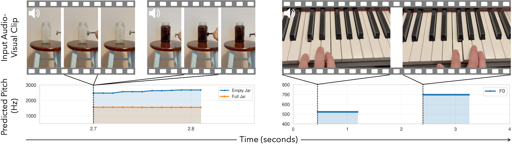

# Benchmarking Single-Factor Physical Video-to-Audio Generation

Tingle Li, Siddharth Gururani, Kevin J. Shih, Gantavya Bhatt, Sang-gil Lee, Zhifeng Kong, Arushi Goel, Gopala Anumanchipalli, Ming-Yu Liu

**CVPR 2026**

[](https://openaccess.thecvf.com/content/CVPR2026/papers/Li_Benchmarking_Single-Factor_Physical_Video-to-Audio_Generation_CVPR_2026_paper.pdf)
[](https://research.nvidia.com/labs/cosmos-lab/flatsounds/)
[](docs/leaderboard.md)
[](https://huggingface.co/datasets/Tinglok/FlatSounds)
[](LICENSE)
[](LICENSE-DATA)



FlatSounds tests whether video-to-audio (V2A) models get the physics of sound right. It asks two questions. When exactly one physical factor of a scene changes (the striker, the material, how full a glass is, the room), does the generated audio change the way real sound does? And do the generated hits land when the video shows them?

## News

- **2026-11**: We release FlatSounds-Physics **Verified**, a re-checked and extended version of the paper's test set. It is the default; please report results on it (see [What Changed in Verified](#what-changed-in-verified)).
- **2026-11**: Evaluation code and data released.
- **2026-02**: FlatSounds is accepted to CVPR 2026.

## Overview

|  | FlatSounds-Physics | FlatSounds-Single |
|---|---|---|
| Question | Does the sound change correctly when one physical factor changes? | Do the generated hits occur when the video shows them? |
| Data | 302 test cases: 175 video pairs and 127 single videos | 185 original recordings with 464 annotated hits |
| What is checked | 724 tests on 9 acoustic metrics (pitch, decay, brightness, reverberation, ...): does each metric change in the right direction, or stay the same when it should? | Detected hits against the annotated hit times (±0.1 s) |
| Headline score | [Confidence](docs/metrics.md#headline-numbers) (0-1) | [Hit F1](docs/metrics.md#headline-numbers) (0-1) and timing error (ms) |

## Installation

Requires Python 3.12 or newer (uv installs it if missing).

```bash
git clone https://github.com/Tinglok/flatsounds.git
cd flatsounds
pip install uv  # or: curl -LsSf https://astral.sh/uv/install.sh | sh
uv sync
source .venv/bin/activate
```

## Check the Installation

Score the example outputs in [`examples/`](examples) and compare them with the stored results. The first run downloads the CLAP model (about 0.8 GB).

```bash
python evaluate_physics.py --generated_audio_dir examples/physics --metadata_path examples/physics.json \
    --num_runs 5 --output_dir evaluation_results/examples
python evaluate_single.py --generated_audio_dir examples/single --metadata_path examples/single.json \
    --num_runs 5 --output_dir evaluation_results/examples
python examples/compare.py examples/expected evaluation_results/examples
```

You should see:

```
physics_results.json: OK
single_results.json: OK
```

## Data

Download the videos (the model inputs) from [Hugging Face](https://huggingface.co/datasets/Tinglok/FlatSounds). Accept the access conditions on the dataset page, then:

```bash
hf auth login
hf download Tinglok/FlatSounds --repo-type dataset --local-dir FlatSounds
```

This gives `benchmark_warped_clips/` (542 FlatSounds-Physics videos) and `benchmark_clips_full/` (185 FlatSounds-Single videos).

The videos keep their recorded sound: give your model only the video frames, and save the generated audio as separate files.

The captions, hit times and expected changes are in [`benchmark/`](benchmark); [Data](docs/data.md) describes the format and shows [how to list every video with its caption](docs/data.md#listing-the-videos).

## Generating Outputs

Run your model on every video with random seeds 0-9 and save one file per video and seed, named after the video:

```
your_model_output/                                   your_model_output_single/
├── fullness_1h_01_f0007cf0008_factual_seed0.wav     ├── clip_001_seed0.wav
├── ...                                              ├── ...
└── fullness_1h_01_f0007cf0008_factual_seed9.wav     └── clip_001_seed9.wav
```

Each file holds the audio of the whole video, starting at its first frame. Any sample rate works; WAV or FLAC is safest (other formats: [Generated Audio](docs/data.md#generated-audio)). Text-conditioned models can use the caption of each video from the metadata.

## Evaluation

```bash
# FlatSounds-Physics (verified split; for the paper's, add --split paper and a different --output_dir)
python evaluate_physics.py --generated_audio_dir ./your_model_output

# FlatSounds-Single
python evaluate_single.py --generated_audio_dir ./your_model_output_single
```

Each run prints a summary and saves the results to `evaluation_results/<generated_audio_dir name>/`. See [Evaluation Options and Outputs](docs/evaluation.md) and [Metrics and Scoring](docs/metrics.md) for details.

## Reporting Results

Report the **confidence** and **net confidence** of FlatSounds-Physics (verified split) and the **hit F1** and **timing error** of FlatSounds-Single, all printed at the end of each run. If your model takes text, say whether it used the captions. To add your model to the [leaderboard](docs/leaderboard.md), see [Submitting Results](docs/leaderboard.md#submitting-results).

## What Changed in Verified

We re-checked every test of the paper's FlatSounds-Physics against physics and the original recordings, removed the ones that do not hold or that duplicate another test, and added new test cases built from the same recordings. **Verified** is the default; `--split paper` still evaluates the paper's test set. Scores in this repository differ from the paper's tables because the metrics were re-implemented and timing credit now counts only the hits matched above chance. FlatSounds-Single now reports hit F1, which also counts extra hits.

|  | Paper | Verified |
|---|---|---|
| Test cases | 268 | 302 (37 removed, 71 added) |
| Tests | 620 | 724 (137 removed, 241 added) |
| Videos | 446 | 462 (96 of them new) |

Tests per metric:

| Split | Attack | Decay | F0 | Centroid | Flux | Rolloff | Temp. Mod. | RT60 | DRR |
|---|---|---|---|---|---|---|---|---|---|
| Paper | 91 | 94 | 69 | 171 | 43 | 64 | 22 | 35 | 31 |
| **Verified** | 53 | 119 | 85 | 157 | 37 | 67 | 26 | 110 | 70 |

## Citation

```bibtex
@inproceedings{li2026benchmarking,
  title={Benchmarking Single-Factor Physical Video-to-Audio Generation},
  author={Li, Tingle and Gururani, Siddharth and Shih, Kevin J. and Bhatt, Gantavya and Lee, Sang-gil and Kong, Zhifeng and Goel, Arushi and Anumanchipalli, Gopala and Liu, Ming-Yu},
  booktitle={Proceedings of the IEEE/CVF Conference on Computer Vision and Pattern Recognition (CVPR)},
  year={2026}
}
```

## License

The code is released under the [MIT License](LICENSE). The FlatSounds data (the videos, the annotations and metadata in [`benchmark/`](benchmark), and the example audio and metadata in [`examples/`](examples)) is released under [CC BY-NC 4.0](LICENSE-DATA): free for non-commercial use, with attribution.
